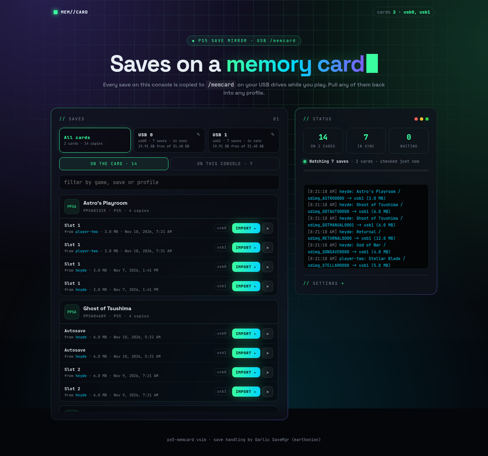
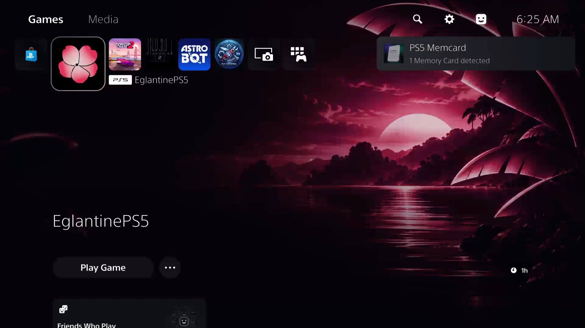

# ps5-memcard

A memory card for a jailbroken PS5. The payload watches every save on the console
(PS5 and PS4 titles, all profiles) and keeps a copy on a USB drive under `/memcard`.
Several drives can be memory cards at once; every card gets every save.
Its web page shows what is on each card, imports any card save into any profile on
the console, and backs up a save on demand.



Built on [Garlic SaveMgr](https://github.com/earthonion/garlic-savemgr) by earthonion:
the native save mounting, re-signing and import code is Garlic's. The page follows
the look of [sendpayload.pages.dev](https://sendpayload.pages.dev).

## Use

1. Plug a USB drive (exFAT or FAT32) into the PS5.
2. Send `ps5-memcard.elf` to the ELF loader (port 9021).
3. Open `http://<ps5-ip>:8083/`.

From then on it runs by itself until the console reboots. Sending the payload again
replaces the running copy.

Loading the payload also:

- adds a **PS5 Memcard** shortcut to the **Media** tab of the home screen, which
  opens the page in the console's own browser (`http://127.0.0.1:8083/`);
- shows a notification, with the same icon, saying how many memory cards were
  found: *PS5 Memcard / 2 Memory Cards detected*.



The shortcut stays on the Media tab after a reboot, but it only has a page to open
while the payload is loaded. Delete it like any other app if you no longer want it.

| Tab | What you get |
| --- | --- |
| **Drive tiles** | One per connected USB drive: its name, saves, free space, and a turning PS1-style memory card with the card's name on its label. Click a card to work with that card only, the pencil to name it, **Use as card** to start using a drive that is not a card yet. |
| **On the card** | Every save on the selected card (or all cards), grouped by game, with the profile it came from. **Import** copies it into the profile you pick. **×** deletes that copy. |
| **On this console** | Every save on the console and whether it is on each card yet. **Back up** copies one now, **Back up game** / **Back up all** do the same in bulk, to the selected card or to all of them. |
| **Status** | Counters, the running copy, an activity log, and the settings. |

## Several memory cards

- A connected drive with a `/memcard` folder is a memory card. Every card that is
  plugged in gets every save, and each keeps its own index, so cards can come and
  go: a card that was away catches up when it is back.
- With no card connected, the first drive becomes one by itself.
- Any other drive is left untouched until you press **Use as card** on its tile
  (or switch on *use every connected USB drive as a memory card* in Settings).
- *Back up to* in Settings can limit everything to the drive on one port.
- A card can be given a name. It is stored on the card (`/memcard/label.txt`), so
  it follows the drive from port to port and console to console.
- To stop using a drive as a card, delete its `/memcard` folder.

## How the backup behaves

- The console is checked every 5 s. A save is copied once it has been unchanged for
  15 s (*quiet time*), so a save that is still being written is left alone.
- While a game is running, the same save is copied at most every 5 min (*in-game
  gap*). When the game closes its saves are copied right away, and compared byte by
  byte in case the file changed without a new timestamp.
- A copy is written next to the old one and swapped in only when complete. If the
  save changed while it was being copied, the copy is thrown away and retried.
- The previous copy of each save is kept as `<save>.prev` and can be imported too.
- An older console save never replaces a newer card copy by itself (shown as
  *card is newer*). Backing it up by hand overrides that.
- All of the above is tracked per card.
- Nothing is written unless `/mnt/usbN` is a real mounted drive.
- One console notification per pass, none over a running game.

All of this is in Settings on the page, stored in `/data/memcard/config.json`.

## Card layout

```
/memcard/index.tsv                      what was copied, from which save state
/memcard/label.txt                      name of the card (optional)
/memcard/<user id>/profile.txt          name of the profile
/memcard/<user id>/<TITLE>/<save>       the save image, byte for byte
/memcard/<user id>/<TITLE>/<save>.prev  the copy before that
/memcard/<user id>/<TITLE>/<name>.bin   PS4 sealed key that belongs to the image
```

A decrypted save folder (with `sce_sys/`, as exported by Garlic SaveMgr together
with its `chives.json`) dropped into `/memcard/<user id>/<TITLE>/` is listed and
can be imported as well.

Importing never touches the card: the save is copied to `/data/memcard/import`,
re-signed for the chosen profile there, and installed from there. Importing the
save of a game that is running is refused.

## API

Everything the page does, on port 8083:

| | |
| --- | --- |
| `GET /api/mc/status` | connected drives and which are cards, counters, running copy, activity, settings, profiles |
| `GET /api/mc/card[?usb=N]` | saves on the cards (or on one) |
| `GET /api/mc/console` | saves on the console and their state, overall and per card |
| `POST /api/mc/backup?uid=&title=&save=[&usb=N]` | queue a backup; any part may be left out, or `all=1`; `usb` limits it to one card |
| `POST /api/mc/import?id=<uid/TITLE/save>&uid=<profile>[&usb=N][&previous=1]` | import a card save |
| `POST /api/mc/delete?id=<uid/TITLE/save>[&usb=N]` | delete a card save |
| `POST /api/mc/card_init?usb=N` | start using a connected drive as a memory card |
| `POST /api/mc/label?usb=N&name=` | name a card (empty name removes it) |
| `GET` / `POST /api/mc/settings` | read / change settings (JSON body) |
| `GET /api/mc/icon?title=<TITLE>` | game icon |

Garlic SaveMgr's own endpoints (`/api/saves`, `/api/log`, `/api/mount`, ...) are
still there; its page, cloud/FTP watcher and UI are not used.

## Home screen shortcut, icon and notifications

- `assets/icon0.png` is the 3D card from `src/card3d.js` on the page's own
  background (same colours and placement as the page, a little stronger so it
  reads at icon size). `make icon` renders it again with `tools/make-icon.cjs`.
- `src/homescreen.c` writes a title directory `/user/app/MEMC00001` with
  `assets/param.json` (`applicationCategoryType` 65536 is a Media tab link,
  `deeplinkUri` is the page) and registers it with the system, the way ftpsrv,
  ps5-payload-manager and ps5-web-file-manager add theirs. It is only written
  when missing or out of date.
- Notifications go through `sceNotificationSend` with the `ToastTemplateA`
  layout, which takes an icon from a file. The system UI reads it from
  `/user/data/memcard/icon0.png` (it cannot see `/data`). Backup notifications use
  the same toast. If the system refuses a toast, a plain text notification is
  sent instead.
- The page also works in the console's browser. There the card icons show as the
  flat drawing instead of the 3D model.

## The card icons

The memory card on each tile is a small three.js model built in code
(`src/card3d.js`): no model file, the print and the label are painted on a canvas.
One WebGL context draws all of them. three.js itself (`vendor/`, MIT) is gzipped
into the payload and served from the console, so the page needs no internet. With
WebGL or the script unavailable the tiles show a flat drawing instead, and with
"reduce motion" set the cards stand still.

## Build

Needs the [PS5 Payload SDK](https://github.com/ps5-payload-dev/sdk) and a host
clang/lld.

```sh
make PS5_PAYLOAD_SDK=/path/to/ps5-payload-sdk     # -> ps5-memcard.elf
```

## Test without a console

The memory card logic (`src/memcard.c`) is plain POSIX and runs on a PC.

```sh
make test          # watcher / index / staging rules against a fake tree
make sim           # the real page + the real core on http://127.0.0.1:8083/
npm install && make build/sim build/ui.html build/three.module.min.js.gz && npx playwright test   # browser tests
```

`make sim` fakes only the import step (that needs the console's save crypto).

## Tested on a console

On a PS5 with one USB exFAT drive: drive detection (empty ports are ignored),
automatic mirror (card copy byte-identical to the console save), previous-copy
rotation, manual backup, import of a decrypted folder, import of a mirrored image
(the installed save mounts and holds its files), delete, naming the card,
replacing a running instance, the 3D icon with three.js served by the console,
the Media tab shortcut (registered, its hub page shows the icon and a Start
button), the start-up notification with the icon, and the page in the console's
own browser.

Not yet exercised on hardware: two drives plugged in at once (covered by the host
and browser tests only), PS4 saves, and moving a card between two consoles.

## Layout of the source

- `src/memcard.c`, `src/memcard.h`: the memory card (watcher, index, staging, `/api/mc/*`).
- `src/ui.html`, `src/card3d.js`: the page and its 3D card icons, embedded into the payload at build time.
- `src/homescreen.c`, `assets/`: Media tab shortcut, its icon, and the toasts.
- `tools/`: the icon renderer.
- `vendor/`: three.js r160 (MIT), served by the payload.
- `src/main.c`, `src/CMP/`: Garlic SaveMgr, with the glue marked `memcard glue`.
- `tests/`: host test, simulator, browser tests.

## Credits

Garlic SaveMgr by earthonion and contributors. Upstream ships without a license
file, which is one reason this repository is private.
